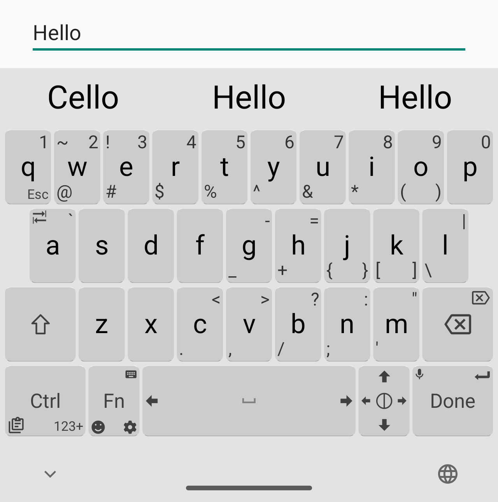
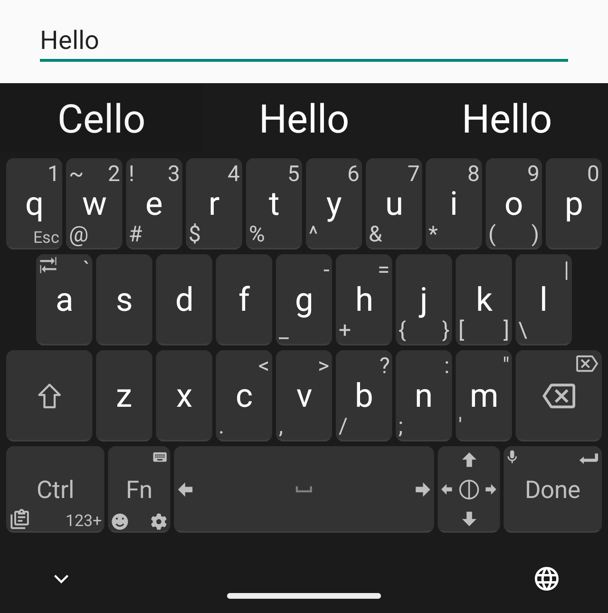
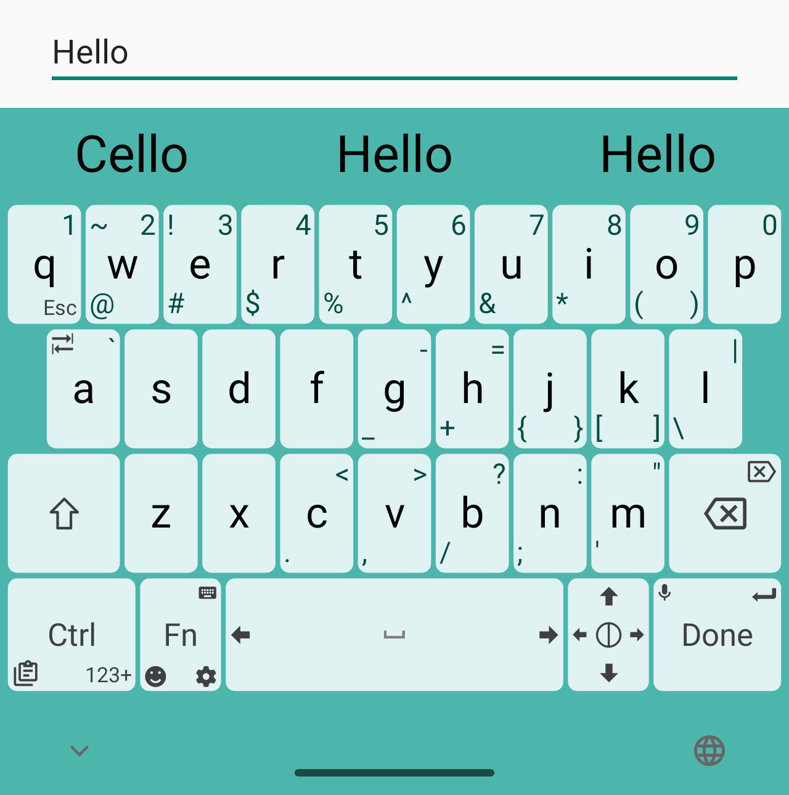
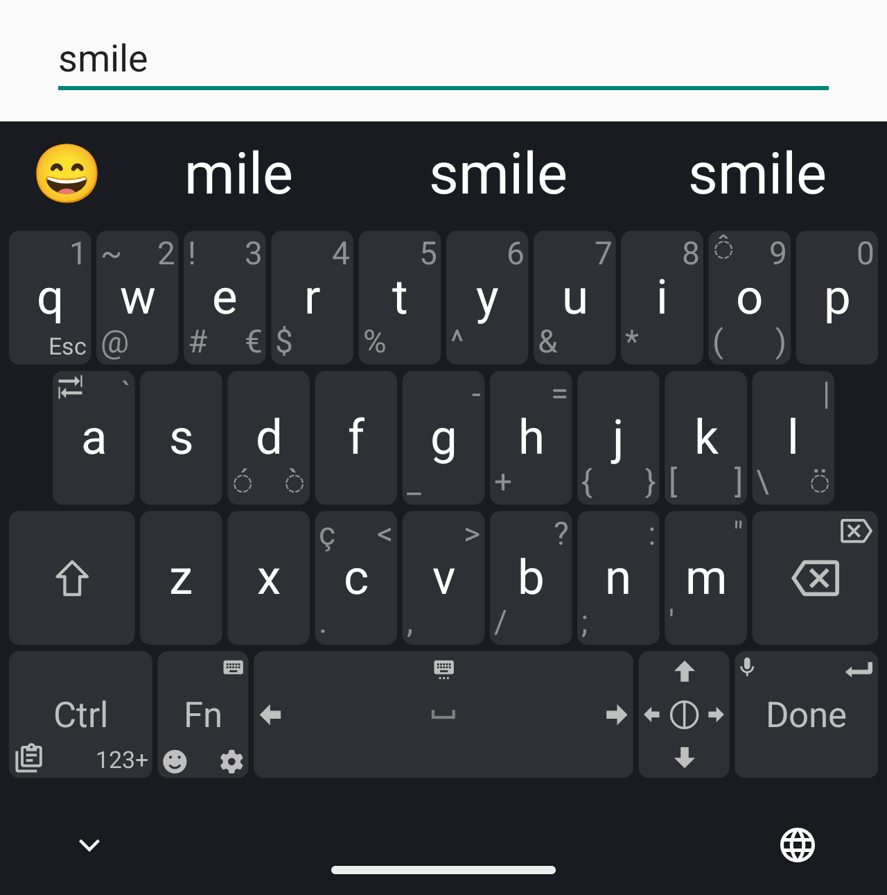
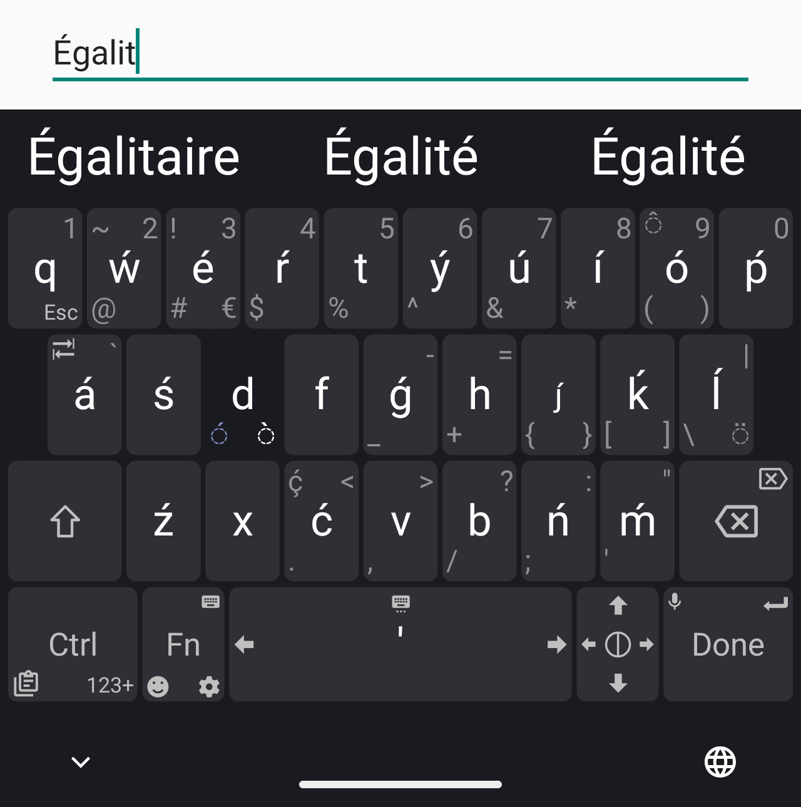

# TypoDev Keyboard — Type Faster, Write Smarter

[](https://github.com/ItsAsadullah/TypoDev/releases/latest)
[-3DDC84?logo=android&logoColor=white)](https://github.com/ItsAsadullah/TypoDev/releases/latest)
[](LICENSE)
[](https://github.com/ItsAsadullah)

**TypoDev** (`typodev.keyboard`) is a fast, lightweight (~2.8 MB), privacy-focused Android virtual keyboard developed and maintained by **[Md Asadullah (@ItsAsadullah)](https://github.com/ItsAsadullah)**. It combines effortless **Bengali (Avro Phonetic, Banglish & Jatiyo)** and multi-language typing with a built-in **AI Writing Assistant, Step-by-Step Math Solver, Vision OCR, Live Translator, Smart Clipboard, Snippets, Voice Typing, and Full Theme Customization**.

> **বাংলা সংক্ষেপ:** **TypoDev Keyboard** হলো অ্যান্ড্রয়েডের জন্য একটি দ্রুতগতির, হালকা ও প্রাইভেসি-সুরক্ষিত বাংলা ও ইংরেজি এআই কিবোর্ড (অভ্র ফনেটিক, বাংলিশ ও জাতীয় লেআউট, এআই রাইটিং টুলস, ম্যাথ সলভার, লাইভ ট্রান্সলেটর, ভয়েস টাইপিং ও স্মার্ট ক্লিপবোর্ড সহ)।

---

## Download & Install

- **Latest Stable Release:** [**Download TypoDev APK (GitHub Releases)**](https://github.com/ItsAsadullah/TypoDev/releases/latest)
- **Direct APK (`v2.1.7`):** [`TypoDev-2.1.7-release.apk`](https://github.com/ItsAsadullah/TypoDev/releases/download/v2.1.7/TypoDev-2.1.7-release.apk)
- **Supported Architectures:** Universal APK (`arm64-v8a`, `armeabi-v7a`, `x86`, `x86_64`) for Android 5.0 (Lollipop) through Android 15+.
- **In-App Updates:** Starting from `v2.1.7`, TypoDev includes a built-in GitHub Release update checker (**Settings → About → Check for Updates**).

---

## Key Features

### 1. Bengali (Avro Phonetic, Banglish & Jatiyo) + Multi-Language Typing
- **Avro Phonetic & Smart Banglish Engine:** Type Bengali naturally using phonetic Roman script (`ami banglay gan gai` → `আমি বাংলায় গান গাই`) backed by a 43,000+ word lexicon and personalized user dictionary learning.
- **Jatiyo & Flick Sub-Keys:** Slide toward any corner of a key to input secondary characters, vowel signs, conjuncts, numbers, and symbols instantly without switching layouts.
- **Focus Mode:** One-tap clean keyboard toggle that hides extra corner clutter while preserving essential Bengali characters and conjunct sub-keys.
- **Context-Aware Suggestions & Autocorrect:** Fast on-device typo correction, next-word prediction, ordinal & contraction formatting, code syntax helpers, and one-tap Backspace undo.

### 2. AI Writing Assistant, Vision OCR & Math Solver
- **Multi-Provider AI Support:** Works with **Google Gemini** (`gemini-2.0-flash`, `gemini-2.5-flash`, etc.) as well as **OpenAI-compatible / Groq** endpoints using your own API key.
- **In-Keyboard AI Pane & Slash Commands:** Rewrite, proofread grammar, adjust tone, summarize, translate, generate replies, or run inline slash commands (`/fix`, `/reply`, `/short`, `/code`) directly inside any app.
- **Vision AI & Screen/Image Text Extraction:** Extract text from screenshots or photos and ask AI questions about visual content.
- **Math Solver & Inline Calculator:** Evaluate arithmetic and algebraic identities inline (e.g., `(a+b)^2 =`, `(2x+3)(2x+5) =`) or open the dedicated **Math Solver** pane for worked school-notebook solutions in Bengali and English.

### 3. Productivity & Customization Tools
- **Smart Clipboard Manager:** Pin important text clips, copy/paste images, filter & search history, and trigger quick AI actions on copied text.
- **Text Expansion Snippets:** Save reusable shortcuts (emails, addresses, templates) that expand as you type.
- **Live In-Keyboard Translate Bar:** Real-time multi-language translation directly into the target input field, including an offline English–Bengali dictionary pack.
- **Voice Typing:** Fast speech-to-text with spoken punctuation commands in Bengali, English, and major world languages.
- **OTP & Password Autofill:** Consent-based SMS OTP detection and strong password generator.
- **Theme & Key Symbol Customizers:** Customize key colors, borders, backgrounds, Bangla fonts (including Kalpurush), and per-key corner symbols.

### 4. Privacy & Security First
- **Password Field Protection:** Suggestions, learning, clipboard auto-capture, and AI tools are automatically disabled in password and sensitive fields.
- **Direct Boot Ready:** Works reliably on Android lock screens immediately after reboot before credential storage is unlocked.
- **User-Controlled AI Keys:** No hidden analytics or keystroke servers—AI requests are sent only when you explicitly invoke an AI tool.

---

## Screenshots

|  |  |  |
| --- | --- | --- |
|  |  |  |

---

## Documentation & Guides

- [Magic Tools & AI Assistant Guide (ম্যাজিক টুল গাইড)](doc/magic-tools-guide.md)
- [AI Slash Commands Reference](doc/AI-slash-commands.md)
- [OTP Autofill Setup Guide](doc/otp-autofill-guide.md)
- [Clipboard & Arabic/Multi-Script Guide](doc/clipboard-arabic-guide.md)
- [Custom Layouts Guide](doc/Custom-layouts.md)
- [Possible Key Values Reference](doc/Possible-key-values.md)
- [Building from Source](CONTRIBUTING.md)

---

## Quick Build Instructions

```bash
git clone --recurse-submodules https://github.com/ItsAsadullah/TypoDev.git
cd TypoDev
./gradlew testDebugUnitTest assembleDebug
```

---

## Author & Credits

- **Developer & Maintainer:** **[Md Asadullah (@ItsAsadullah)](https://github.com/ItsAsadullah)**
- **Repository:** [https://github.com/ItsAsadullah/TypoDev](https://github.com/ItsAsadullah/TypoDev)
- **License:** Released under the [GNU General Public License v3.0 (GPLv3)](LICENSE). Built upon the open-source foundation of Unexpected Keyboard (`juloo.keyboard2`), with thanks to upstream contributors and the [NLnet foundation](https://nlnet.nl/).
